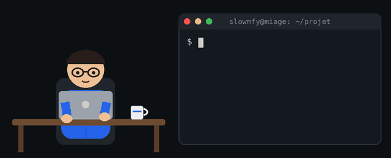

<!-- ===================== EN-TÊTE ===================== -->

  
  
  
  
  

---

## À propos

Je transforme des idées en applications **modernes, utiles et performantes**, avec un intérêt particulier pour le **développement web**, l'**architecture logicielle** et l'**intelligence artificielle**.

| | |
|---|---|
| **Formation** | Licence **MIAGE** obtenue — Master 1 **MIAGE** en cours, Université Grenoble Alpes |
| **Objectif** | Travailler sur des problématiques réelles autour de **React, Angular, Spring, Django et l'IA** |
| **Localisation** | Grenoble, France |

  

---

## Parcours et compétences

| Diplôme | Statut | Compétences |
|---|---|---|
| **Licence — parcours Ingénierie des systèmes d'information** | Obtenue | Algorithmique et programmation, systèmes d'exploitation, réseaux, bases de données, analyse et conception des systèmes d'information (Merise, UML), génie logiciel, développement web |
| **Licence 3 MIAGE** — Université Grenoble Alpes | Obtenue | Programmation orientée objet (Java), bases de données relationnelles et SQL, développement web, génie logiciel, réseaux, fondamentaux de gestion et de comptabilité |
| **Master 1 MIAGE** — Université Grenoble Alpes | En cours | Processus de développement logiciel et méthodes agiles, patrons de conception et composants, modélisation UML et des exigences, ingénierie des IHM, administration de bases de données, systèmes et réseaux, développement mobile, analyse de données, gestion financière et de production, contrôle de gestion, droit du numérique |
| **Master 2 MIAGE** — Université Grenoble Alpes | À venir | Modélisation des processus métier, gestion de projets informatiques, conduite du changement, big data, IoT et technologies émergentes, systèmes de gestion des connaissances, systèmes d'information spécialisés, entrepreneuriat |

---

## Stack technique

**Frontend**

**Backend & Bases de données**

**Outils**

---

## Méthodes de travail

| Domaine | Pratiques |
|---|---|
| **Gestion de projet** | Méthodes agiles (Scrum, Kanban), découpage en user stories, revues de sprint |
| **Conception** | Modélisation UML et analyse des exigences, patrons de conception, architecture en couches |
| **Développement** | Git et pull requests, conventions de nommage, code lisible et documenté |
| **Qualité** | Tests d'API (Postman), tests unitaires, revue de code |
| **Automatisation** | Intégration continue avec GitHub Actions |
| **Collaboration** | Travail en équipe sur des projets universitaires, communication en français et en anglais |

---

## Projets

| Projet | Description | Stack |
|---|---|---|
| [**Refonte du site universitaire**](https://github.com/ranidzkellou/Projet-DevWeb2) | Refonte complète : structure, interface et expérience utilisateur | `HTML` `CSS` `JavaScript` |
| [**Calculateur de Zakat pour entreprises**](https://github.com/6laza/Awkaf) | Calcul de la zakat d'une entreprise à partir de ses données financières | `JavaScript` |
| [**Application Peer-to-Peer**](https://github.com/slowmfy/Peer2peer-java-) | Connexion directe entre utilisateurs via sockets | `Java` `Sockets` `Réseaux` |

---

## Statistiques GitHub

## Activité des commits

<picture>
  <source media="(prefers-color-scheme: dark)" srcset="https://raw.githubusercontent.com/slowmfy/slowmfy/output/contributions-dark.svg" />
  
</picture>

## Succès GitHub

  
  
  
  

---

**N'hésitez pas à me contacter, je réponds rapidement !**

